<!--
  hey, you opened the source. respect.
  the key isn't hidden in here. it's hidden in plain sight, three layers deep.
  everything on this page is generated by scripts/build.py, read it if you're curious.
-->

<div align="center">

<picture>
  <source media="(prefers-color-scheme: dark)" srcset="./assets/live/hero-dark.svg" />
  <source media="(prefers-color-scheme: light)" srcset="./assets/live/hero-light.svg" />
  
</picture>

<picture>
  <source media="(prefers-color-scheme: dark)" srcset="./assets/live/pulse-dark.svg" />
  <source media="(prefers-color-scheme: light)" srcset="./assets/live/pulse-light.svg" />
  
</picture>

<a href="https://www.linkedin.com/in/shriyan-bohra-647057386/"></a>
<a href="mailto:shriyanbohra24077@gmail.com"></a>
<a href="https://r-h-t-i-h.vercel.app"></a>
<a href="#shell"></a>
<a href="#vault"></a>

</div>

<a name="shell"></a>

<picture>
  <source media="(prefers-color-scheme: dark)" srcset="./assets/live/head-shell-dark.svg" />
  <source media="(prefers-color-scheme: light)" srcset="./assets/live/head-shell-light.svg" />
  
</picture>

<picture>
  <source media="(prefers-color-scheme: dark)" srcset="./assets/live/shell-dark.svg" />
  <source media="(prefers-color-scheme: light)" srcset="./assets/live/shell-light.svg" />
  
</picture>

<!--KEYS:START-->
<table align="center">
<tr><td valign="top"><details><summary><a name="cmd-0"></a></summary><a name="out-0"></a></details></td><td valign="top"><details><summary><a name="cmd-1"></a></summary><a name="out-1"></a></details></td></tr>
<tr><td valign="top"><details><summary><a name="cmd-2"></a></summary><a name="out-2"></a></details></td><td valign="top"><details><summary><a name="cmd-3"></a></summary><a name="out-3"></a></details></td></tr>
<tr><td valign="top"><details><summary><a name="cmd-4"></a></summary><a name="out-4"></a></details></td><td valign="top"><details><summary><a name="cmd-5"></a></summary><a name="out-5"></a></details></td></tr>
<tr><td valign="top"><details><summary><a name="cmd-6"></a></summary><a name="out-6"></a></details></td><td valign="top"><details><summary><a name="cmd-7"></a></summary><a name="out-7"></a></details></td></tr>
</table>
<!--KEYS:END-->

<div align="center">
<br/>

<a href="https://github.com/Shriyan2407/Shriyan2407/issues/new?title=shell%3A%20&body=Just%20press%20%2A%2ACreate%2A%2A.%20A%20bot%20runs%20your%20command%20in%20about%2030%20seconds%2C%20replies%20here%2C%20and%20puts%20it%20on%20the%20profile%20for%20everyone%20to%20see."></a>

<sub>▲ click any command above and its output opens right here · the gold key runs one for real: a bot replies in ~30s and puts your @username on the big screen</sub>

</div>

<a name="cases"></a>

<picture>
  <source media="(prefers-color-scheme: dark)" srcset="./assets/live/head-cases-dark.svg" />
  <source media="(prefers-color-scheme: light)" srcset="./assets/live/head-cases-light.svg" />
  
</picture>

<div align="center">

<a href="https://github.com/Shriyan2407/r-h-t-i-h"></a>
<a href="https://github.com/Shriyan2407/DOCCARE"></a>
<a href="https://github.com/Shriyan2407/CIRCUIT-X"></a>
<a href="https://github.com/Shriyan2407/nebulavoltage"></a>

<sub>
<b>joint operations</b> · <a href="https://github.com/SathyaMaragani/Vesyn-MSA">Vesyn-MSA</a> (multi-agent drug discovery) · <a href="https://github.com/SathyaMaragani/26087-ERP">26087-ERP</a> · <a href="https://github.com/s4meer-dev/-Air-Quality-AeroPure-">AeroPure</a> (air-quality ML)
<br/>
<b>under study</b> · <a href="https://github.com/Shriyan2407/hyperswitch">hyperswitch</a> (Rust payments) · <a href="https://github.com/Shriyan2407/rocketride-server">rocketride</a> (C++ AI pipelines) · <a href="https://github.com/Shriyan2407/hydradb">hydradb</a> (Rust graph DB)
</sub>

</div>

<a name="vault"></a>

<picture>
  <source media="(prefers-color-scheme: dark)" srcset="./assets/live/head-vault-dark.svg" />
  <source media="(prefers-color-scheme: light)" srcset="./assets/live/head-vault-light.svg" />
  
</picture>

<picture>
  <source media="(prefers-color-scheme: dark)" srcset="./assets/live/vault-dark.svg" />
  <source media="(prefers-color-scheme: light)" srcset="./assets/live/vault-light.svg" />
  
</picture>

I hid a key on this page. Recruiters can scroll past. Hackers can't.

```text
──────────────── INTERCEPTED TRANSMISSION ────────────────
546c4251556b5a4749466853544341394945457758305a4d
526b6453576c3957526c3947546c4e53
───────────────────────────────────────────────────────────
layer 3 ▸ sixteen symbols are enough to say anything.
layer 2 ▸ sixty-four symbols. sometimes padded, not today.
layer 1 ▸ caesar took thirteen steps and called it a day.
```

**Prove it without leaking it.** Don't post the key. Post a hash that only works for *your* username:

```bash
printf '%s' "your-github-username:THE_KEY" | sha256sum
```

**[ ▶ Submit your hash ](https://github.com/Shriyan2407/Shriyan2407/issues/new?title=vault%3A%20PASTE_YOUR_SHA256_HERE&body=Replace%20the%20title%20with%20%60vault%3A%20%3Cyour%20sha256%3E%60%20and%20submit.%20A%20bot%20will%20judge%20your%20attempt%20in%20about%20a%20minute.)**. A bot judges it in about a minute, replies, and the vault above updates for everyone.

#### 🏆 Hall of Fame

<!--HALL:START-->
| # | Hacker | Cracked at |
|:--:|:--|:--|
| — | _nobody yet. the vault is undefeated._ | — |
<!--HALL:END-->

<details>
<summary><b>📜 <code>tail -f /var/log/shriyan.log</code></b>: what I've been doing lately</summary>
<br/>

<!--LOG:START-->
- `2026-10-14 17:57` PUSH     10× → `feat/equitylens-ai-v2` · [**r-h-t-i-h**](https://github.com/Shriyan2407/r-h-t-i-h)
- `2026-10-13 19:47` PR       opened [#1](https://github.com/Shriyan2407/r-h-t-i-h/pull/1) · [**r-h-t-i-h**](https://github.com/Shriyan2407/r-h-t-i-h)
- `2026-10-13 19:47` CREATE   branch `feat/equitylens-ai-v2` · [**r-h-t-i-h**](https://github.com/Shriyan2407/r-h-t-i-h)
- `2026-10-10 06:14` RELEASE  open-sourced [**CIRCUIT-X**](https://github.com/Shriyan2407/CIRCUIT-X)
- `2026-10-02 18:41` PUSH     20× → `main` · [**SathyaMaragani/26087-ERP**](https://github.com/SathyaMaragani/26087-ERP)
- `2026-09-29 15:18` JOIN     collaborator on [**SathyaMaragani/26087-ERP**](https://github.com/SathyaMaragani/26087-ERP)
- `2026-09-25 16:04` FORK     [**hydra-db/hydradb**](https://github.com/hydra-db/hydradb)
- `2026-09-25 16:04` STAR     [**hydra-db/hydradb**](https://github.com/hydra-db/hydradb)
- `2026-09-25 16:03` FORK     [**rocketride-org/rocketride-server**](https://github.com/rocketride-org/rocketride-server)
- `2026-09-25 16:02` STAR     [**rocketride-org/rocketride-server**](https://github.com/rocketride-org/rocketride-server)
<!--LOG:END-->

</details>

<div align="center">
<br/>

<!--UPDATED:START-->
<sub><code>last sync 17 Oct 2026 12:32 UTC · rebuilt every 6h by a bot I wrote</code></sub>
<!--UPDATED:END-->

</div>
